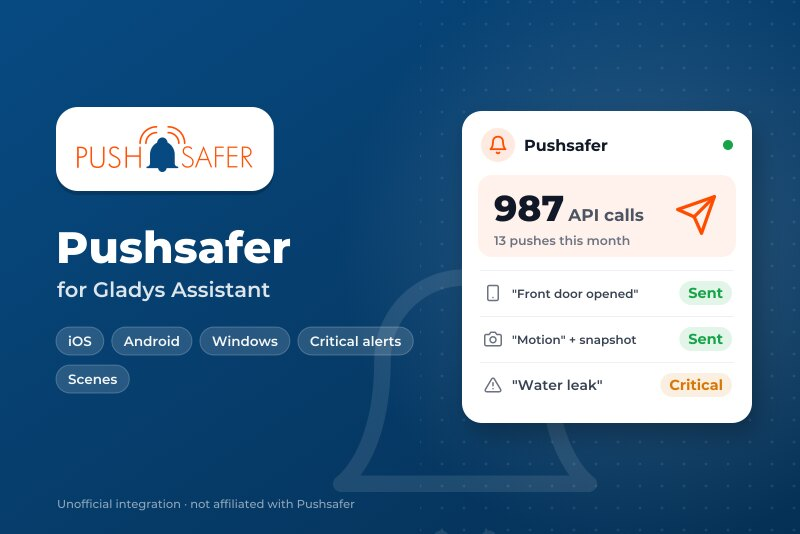
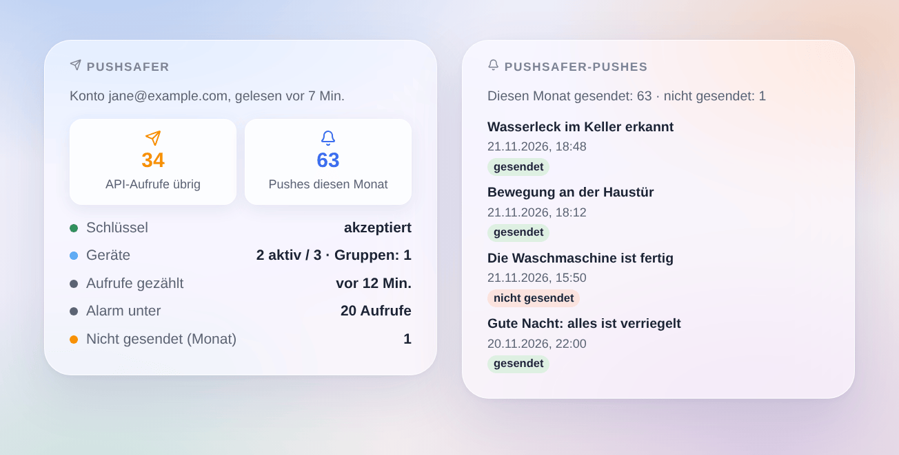
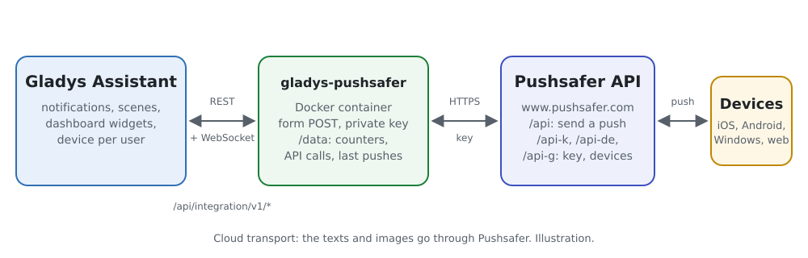
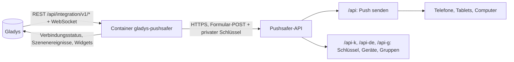
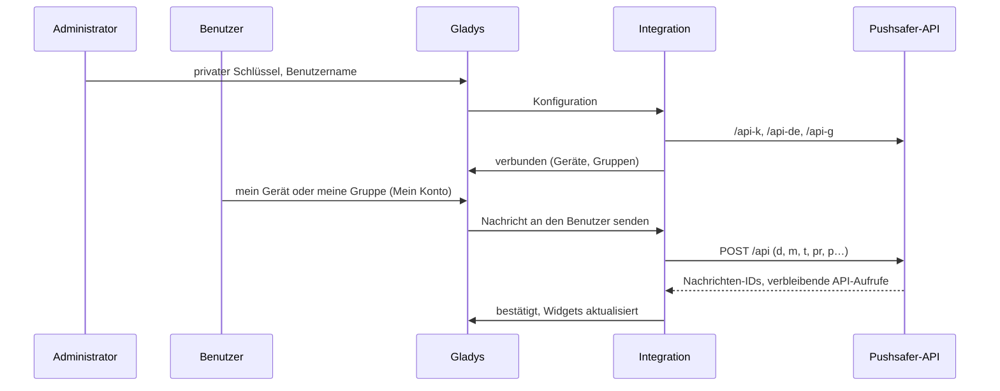

# Gladys Pushsafer

[English](README.md) · [Français](README.fr.md) · **Deutsch** · [Español](README.es.md)

[](LICENSE)
[](https://github.com/William-De71/gladys-pushsafer/releases)
[](https://github.com/William-De71/gladys-pushsafer/actions/workflows/release.yml)
[](https://gladysassistant.com)



Externe Integration für [Gladys Assistant](https://gladysassistant.com), die die Benachrichtigungen von Gladys **als [Pushsafer](https://www.pushsafer.com)-Pushes** an iOS, Android, Windows und Browser sendet, mit Kamerabildern und Prioritäten bis zu kritischen Hinweisen. Szenen können außerdem einen Push an ein beliebiges Gerät oder eine Gruppe senden und auf einen Fehler oder knappe API-Aufrufe reagieren, und zwei Dashboard-Widgets zeigen das Konto und die letzten Pushes.

Benutzerdokumentation: [English](docs/en.md) · [Français](docs/fr.md) · [Deutsch](docs/de.md) · [Español](docs/es.md).

> Community-Integration, weder mit Pushsafer verbunden noch von Pushsafer unterstützt.

## Funktionen

- **Benachrichtigungskanal** (nur Senden): Jeder Benutzer gibt sein Gerät oder seine Gerätegruppe im Block „Mein Konto“ ein; jede an ihn gerichtete Gladys-Benachrichtigung geht als Push hinaus.
- **Bilder**: Ein von Gladys angehängtes Kamerabild erscheint in der Benachrichtigung.
- **Aussehen der Benachrichtigungen**: Titel, Symbol, Ton, Vibration, Priorität („Nicht stören“ umgangen, kritische Hinweise unter iOS) und Aufbewahrungsdauer.
- **Szenenauslöser**: Push nicht gesendet, API-Aufrufe fast aufgebraucht.
- **Szenenaktion**: einen Push an ein beliebiges Gerät oder eine Gruppe senden, mit eigenem Titel, Priorität, Ton, Symbol, Farbe, Link, Aufbewahrungsdauer und Wiederholung bis zum Lesen.
- **Dashboard-Widgets**: Pushsafer-Konto, letzte Pushes.
- **Schaltflächen der Konfigurationsseite**: Verbindung testen (listet Geräte und Gruppen mit ihren IDs auf), Test-Push senden.
- Englisch, Französisch, Deutsch und Spanisch überall.



## Funktionsweise





Von der Konfiguration zum Push:



Schlüssel, Geräte und Gruppen zu lesen kostet keinen API-Aufruf; nur Pushes verbrauchen welche (einen pro erreichtem Gerät).

### Transport

`transports: ["cloud"]`: Die Integration spricht nur mit der Pushsafer-API (`www.pushsafer.com`). Texte und Bilder der Benachrichtigungen verlassen Ihr Netzwerk zu Pushsafer und dann zu den Benachrichtigungsdiensten von Apple, Google oder Microsoft.

## Benachrichtigungen und Geräte

| Eingabe in „Mein Konto“ | Gesendet an            |
| ----------------------- | ---------------------- |
| `a`                     | alle Geräte des Kontos |
| `52`                    | das Gerät 52           |
| `52, 65` oder `52\|65`  | die Geräte 52 und 65   |
| `gs12`                  | die Gerätegruppe gs12  |

„Verbindung testen“ listet die IDs auf. Das Aussehen der Konfiguration (Titel, Symbol, Ton, Vibration, Priorität, Aufbewahrungsdauer) gilt für alle Benachrichtigungen; ein leeres Feld behält die Einstellung des Geräts.

## Szenenauslöser, Aktionen und Widgets

| Art      | Schlüssel       | Anwendungsfall                                                                                            |
| -------- | --------------- | --------------------------------------------------------------------------------------------------------- |
| Auslöser | `push_not_sent` | Über einen anderen Kanal warnen, wenn keine Pushes mehr gehen (API-Aufrufe, Schlüssel, Pushsafer gestört) |
| Auslöser | `api_calls_low` | API-Aufrufe kaufen, bevor sie aufgebraucht sind                                                           |
| Aktion   | `send_push`     | Ein Alarm mit höchster Priorität, wiederholt bis zum Lesen; ein Push an eine andere Gruppe                |
| Widget   | `account`       | Verbleibende API-Aufrufe, Pushes des Monats, Schlüssel, Geräte, Schwelle, letzter Fehler                  |
| Widget   | `recent`        | Die letzten Pushes von Gladys, gesendet oder nicht                                                        |

Beispiele: _Wasserleck_ → Push an die Familiengruppe mit höchster Priorität, jede Minute wiederholt bis zum Lesen; _API-Aufrufe fast aufgebraucht_ → E-Mail an den Administrator; _Push nicht gesendet_ → SMS über eine andere Integration. Eine Szenenaktion löst nie einen Auslöser aus, und `push_not_sent` löst nur einmal aus, bis wieder ein Push durchgeht: Eine Szene, die über denselben Kanal warnt, kann keine Schleife bilden.

## Voraussetzungen

- Gladys Assistant 5.3.0 oder neuer (Widgets und Szenen, Katalog-Schlüsselwörter von Gladys 5.3); ältere Instanzen können die Integration nicht installieren.
- Ein Pushsafer-Konto, die Pushsafer-App auf den Geräten und API-Aufrufe (ein kleines Gratiskontingent pro Gerät, danach 0,99 € pro 1.000).

## Installation

- **Aus dem Store**: Integrationen → Pushsafer → Installieren.
- **Über die Repository-URL**: Integrationen → externe Integration → `https://github.com/William-De71/gladys-pushsafer`.
- **Entwicklermodus**: `npm start` mit den von Gladys bereitgestellten Variablen ausführen (siehe Entwicklung).

## Konfiguration

| Feld                         | Standard | Bedeutung                                                               |
| ---------------------------- | -------- | ----------------------------------------------------------------------- |
| Privater Schlüssel           | —        | `secret`, der private Schlüssel des Dashboards oder ein Alias-Schlüssel |
| Benutzername oder E-Mail     | —        | Optional: Schlüssel prüfen, Geräte und Gruppen auflisten                |
| Titel                        | Gladys   | Über jeder Benachrichtigung                                             |
| Symbol                       | —        | 1 bis 181                                                               |
| Ton                          | —        | 0 (lautlos) bis 62                                                      |
| Vibration                    | —        | 1, 2 oder 3 (iOS und Android)                                           |
| Priorität                    | normal   | -2 bis 2                                                                |
| Löschen nach (Minuten)       | 0        | 0 = nie                                                                 |
| Warnung bei wenigen Aufrufen | 20       | Schwelle von `api_calls_low`                                            |
| Mein Konto → Gerät           | —        | Pro Benutzer: `a`, `52`, `52\|65` oder `gs12`                           |

## Verwendung

1. Kopieren Sie den privaten Schlüssel aus dem Pushsafer-Dashboard, füllen Sie die Konfiguration aus und klicken Sie dann auf **Verbindung testen** und **Test-Push senden**.
2. Jeder Benutzer gibt sein Gerät oder seine Gruppe in **Mein Konto** ein.
3. Fügen Sie die Widgets einem Dashboard hinzu und erstellen Sie Szenen mit den Auslösern und der Aktion.

## Entwicklung

```bash
npm install
npm test                       # node --test, nie mit Netzwerkzugriff
npm run lint                   # ESLint
npm run format:check           # Prettier
npx github:GladysAssistant/integration-store . --skip-image-check
scripts/build-cover.sh         # cover.jpg aus docs/assets/cover.svg
docs/illustrations/render.sh   # docs/assets/widgets.<Sprache>.png
```

Lokal liest das SDK `GLADYS_HOST_API_URL`, `GLADYS_INTEGRATION_TOKEN` und `GLADYS_INTEGRATION_SELECTOR` (von Gladys im Entwicklermodus bereitgestellt). `DEBUG=gladys-integration-sdk` zeigt die SDK-Protokolle.

Die Tests decken die Ziele, die Konfiguration und ihre Grenzen, die von Gladys angehängten Bilder, die Antworten von Pushsafer (seine eigenen HTTP-Status 250 bis 280, am echten Dienst beobachtet), die Wiederholung (nur Netzwerkfehler oder 5xx), die Szenenereignisse und ihre Übergänge über einen Neustart hinweg, die Widgets (`validateWidgetContent`), das Manifest, die vier Sprachen, das Release-Skript und die ganze Integration gegen das Fake-Gladys des SDK und eine Fake-Pushsafer-API ab. `test/structure.test.js` friert alle Schlüssel ein, die Benutzer speichern.

## Release-Prozess


Jeder Merge auf `main` startet die CI und berechnet dann die Version aus den [Conventional Commits](https://www.conventionalcommits.org/) seit dem letzten Tag: `feat` → Minor, `fix` / `perf` → Patch, `!` oder `BREAKING CHANGE` → Major (ein Minor unter 1.0.0); `docs`, `chore`, `ci`, `test`, `style`, `refactor`, `build` allein veröffentlichen nichts. Der Changelog-Abschnitt wird erzeugt, der Tag gepusht, das Multi-Architektur-Image gebaut, dann erhält `main` den Release-Commit, das GitHub Release wird erstellt und ein letzter Job prüft das öffentliche Image, den Store-Validator und das Topic.

- Der Titel des Pull Requests wird zum Squash-Commit und dann zur Changelog-Zeile: Schreiben Sie ihn auf Englisch, für den Benutzer (`pr-title.yml` prüft ihn). Bearbeiten Sie `CHANGELOG.md` nie von Hand.
- 1.0.0 ist eine Entscheidung: Actions → Release → Run workflow mit `release-as: 1.0.0`. `dry-run` zeigt Version und Notizen, ohne etwas zu veröffentlichen.
- **Geschützter Branch**: Rulesets verlangen einen Pull Request auf `main` und sperren die `v*`-Tags; nur der Maintainer und Deploy Keys kommen durch. Das Release pusht mit dem Deploy Key der Umgebung `release` (Secret `RELEASE_DEPLOY_KEY`, nur `main`): Ein Lauf von einem anderen Branch erhält ihn nie. `build.yml` und `github-release.yml` starten nicht bei einem Tag: Das Release ruft sie auf, oder starten Sie sie von Hand (Actions → Run workflow, mit `version` für das Image), um ein Release abzuschließen.
- Machen Sie nach dem ersten Release das `ghcr.io`-Paket öffentlich (Package settings → Change visibility), sonst kann Gladys es nicht herunterladen.

## Fehlerbehebung

Siehe [docs/de.md](docs/de.md#fehlerbehebung). Melden Sie Probleme mit den Versionen von Gladys und der Integration, den Plattformen der Geräte und den Protokollen der Integration (fügen Sie nie den privaten Schlüssel ein).

## Mitwirken

Issues und Pull Requests sind willkommen. Führen Sie vor einem Pull Request `npm run format:check && npm run lint && npm test` aus und ändern Sie keinen gespeicherten Schlüssel (siehe [CLAUDE.md](CLAUDE.md)).

## Sicherheit

Siehe [SECURITY.md](SECURITY.md): Melden Sie Schwachstellen vertraulich. Der private Schlüssel ist ein `secret`-Feld, wird nie protokolliert und erscheint nie in einem Szenenereignis, einem Widget oder einer Fehlermeldung. Ein Push wird nur einmal wiederholt, und nur wenn Pushsafer nicht oder mit einem 5xx geantwortet hat: Ein Duplikat ist dann möglich, eine Ablehnung durch Pushsafer wird nie wiederholt.

## Kommende Screenshots

Die Bilder oben sind Illustrationen, keine Screenshots. Echte Screenshots kommen nach `docs/assets/screenshots/` (PNG, 1280 × 800): `configuration.png`, `my-account.png`, `scene-action.png`, `dashboard.png` und eine Benachrichtigung auf einem Telefon (`notification.png`, 1080 × 1920).

## Lizenz

[Apache-Lizenz 2.0](LICENSE) — siehe auch [NOTICE](NOTICE). Pushsafer ist eine Marke ihres Inhabers; diese Community-Integration ist nicht mit ihm verbunden. Danke an die Dokumentation und das SDK von Gladys.
