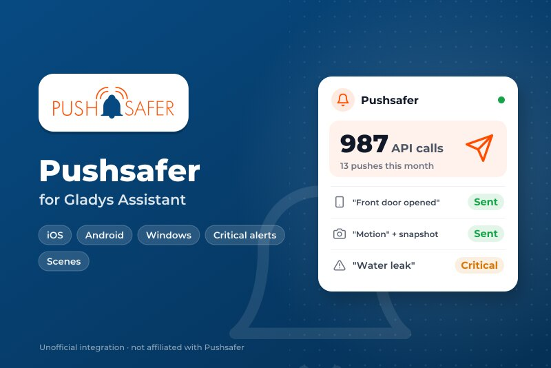
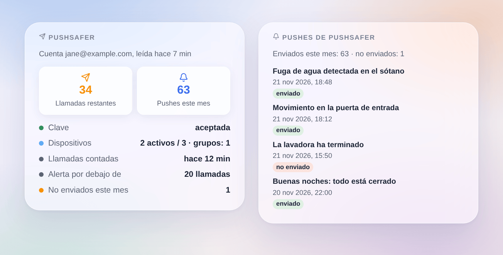
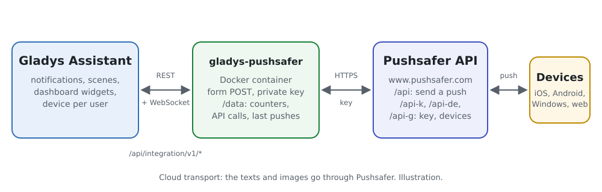
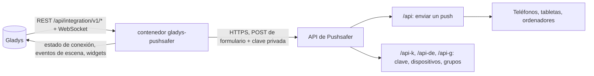
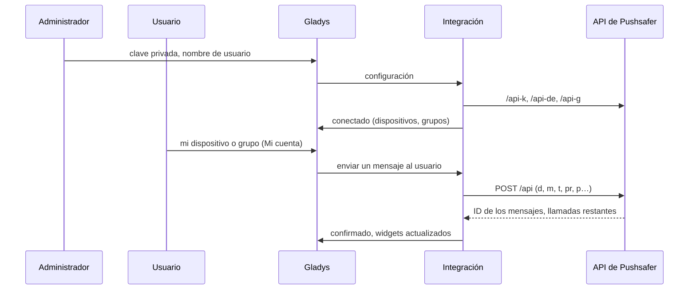

# Gladys Pushsafer

[English](README.md) · [Français](README.fr.md) · [Deutsch](README.de.md) · **Español**

[](LICENSE)
[](https://github.com/William-De71/gladys-pushsafer/releases)
[](https://github.com/William-De71/gladys-pushsafer/actions/workflows/release.yml)
[](https://gladysassistant.com)



Integración externa para [Gladys Assistant](https://gladysassistant.com) que envía las notificaciones de Gladys **como push de [Pushsafer](https://www.pushsafer.com)** a iOS, Android, Windows y navegadores, con imágenes de cámara y prioridades hasta las alertas críticas. Las escenas también pueden enviar un push a cualquier dispositivo o grupo y reaccionar a un fallo o a pocas llamadas a la API, y dos widgets de panel muestran la cuenta y los últimos pushes.

Documentación de usuario: [English](docs/en.md) · [Français](docs/fr.md) · [Deutsch](docs/de.md) · [Español](docs/es.md).

> Integración comunitaria, no afiliada a Pushsafer ni respaldada por él.

## Funcionalidades

- **Canal de notificación** (solo envío): cada usuario indica su dispositivo o grupo de dispositivos en el bloque «Mi cuenta»; cada notificación de Gladys dirigida a él sale como push.
- **Imágenes**: una imagen de cámara adjunta por Gladys se muestra en la notificación.
- **Aspecto de las notificaciones**: título, icono, sonido, vibración, prioridad («No molestar» ignorado, alertas críticas en iOS) y tiempo de conservación.
- **Disparadores de escena**: push no enviado, pocas llamadas a la API.
- **Acción de escena**: enviar un push a cualquier dispositivo o grupo, con su título, prioridad, sonido, icono, color, enlace, tiempo de conservación y repetición hasta que se lea.
- **Widgets del panel**: cuenta de Pushsafer, últimos pushes.
- **Botones de la pantalla de configuración**: probar la conexión (lista los dispositivos y grupos con sus ID), enviar un push de prueba.
- Inglés, francés, alemán y español en todas partes.



## Funcionamiento





De la configuración a un push:



Leer la clave, los dispositivos y los grupos no cuesta ninguna llamada a la API; solo los pushes las consumen (una por dispositivo alcanzado).

### Transporte

`transports: ["cloud"]`: la integración solo habla con la API de Pushsafer (`www.pushsafer.com`). Los textos e imágenes de las notificaciones salen de su red hacia Pushsafer y luego hacia los servicios de notificación de Apple, Google o Microsoft.

## Notificaciones y dispositivos

| Indicado en «Mi cuenta» | Enviado a                           |
| ----------------------- | ----------------------------------- |
| `a`                     | todos los dispositivos de la cuenta |
| `52`                    | el dispositivo 52                   |
| `52, 65` o `52\|65`     | los dispositivos 52 y 65            |
| `gs12`                  | el grupo de dispositivos gs12       |

«Probar la conexión» lista los ID. El aspecto de la configuración (título, icono, sonido, vibración, prioridad, tiempo de conservación) se aplica a todas las notificaciones; un campo vacío mantiene el ajuste del dispositivo.

## Disparadores, acciones de escena y widgets

| Tipo       | Clave           | Caso de uso                                                                               |
| ---------- | --------------- | ----------------------------------------------------------------------------------------- |
| Disparador | `push_not_sent` | Avisar por otro canal cuando los pushes dejan de salir (llamadas, clave, Pushsafer caído) |
| Disparador | `api_calls_low` | Comprar llamadas a la API antes de que se agoten                                          |
| Acción     | `send_push`     | Una alarma con prioridad máxima repetida hasta que se lea, un push a otro grupo           |
| Widget     | `account`       | Llamadas restantes, pushes del mes, clave, dispositivos, umbral, último fallo             |
| Widget     | `recent`        | Los últimos pushes de Gladys, enviados o no                                               |

Ejemplos: _fuga de agua_ → push al grupo familia con la prioridad máxima, repetido cada minuto hasta que se lea; _pocas llamadas a la API_ → correo al administrador; _push no enviado_ → SMS por otra integración. Una acción de escena nunca lanza un disparador, y `push_not_sent` se lanza una sola vez hasta que un push vuelve a salir: una escena que avisa por este mismo canal no puede entrar en bucle.

## Requisitos previos

- Gladys Assistant 5.3.0 o posterior (widgets y escenas, palabras clave del catálogo de Gladys 5.3); las instancias más antiguas no pueden instalar la integración.
- Una cuenta de Pushsafer, la aplicación Pushsafer en los dispositivos y llamadas a la API (una pequeña cuota gratuita por dispositivo, después 0,99 € cada 1000).

## Instalación

- **Desde la tienda**: Integraciones → Pushsafer → Instalar.
- **Desde la URL del repositorio**: Integraciones → integración externa → `https://github.com/William-De71/gladys-pushsafer`.
- **Modo desarrollador**: ejecute `npm start` con las variables que da Gladys (ver Desarrollo).

## Configuración

| Campo                    | Por defecto | Significado                                                |
| ------------------------ | ----------- | ---------------------------------------------------------- |
| Clave privada            | —           | `secret`, la clave privada del panel o una clave alias     |
| Usuario o correo         | —           | Opcional: comprobar la clave, listar dispositivos y grupos |
| Título                   | Gladys      | Encima de cada notificación                                |
| Icono                    | —           | 1 a 181                                                    |
| Sonido                   | —           | 0 (silencio) a 62                                          |
| Vibración                | —           | 1, 2 o 3 (iOS y Android)                                   |
| Prioridad                | normal      | -2 a 2                                                     |
| Borrar tras (minutos)    | 0           | 0 = nunca                                                  |
| Alerta de pocas llamadas | 20          | Umbral de `api_calls_low`                                  |
| Mi cuenta → dispositivo  | —           | Por usuario: `a`, `52`, `52\|65` o `gs12`                  |

## Uso

1. Copie la clave privada desde el panel de Pushsafer, rellene la configuración y pulse **Probar la conexión** y **Enviar un push de prueba**.
2. Cada usuario indica su dispositivo o grupo en **Mi cuenta**.
3. Añada los widgets a un panel y cree escenas con los disparadores y la acción.

## Desarrollo

```bash
npm install
npm test                       # node --test, nunca toca la red
npm run lint                   # ESLint
npm run format:check           # Prettier
npx github:GladysAssistant/integration-store . --skip-image-check
scripts/build-cover.sh         # cover.jpg desde docs/assets/cover.svg
docs/illustrations/render.sh   # docs/assets/widgets.<idioma>.png
```

En local, el SDK lee `GLADYS_HOST_API_URL`, `GLADYS_INTEGRATION_TOKEN` y `GLADYS_INTEGRATION_SELECTOR` (que da Gladys en modo desarrollador). `DEBUG=gladys-integration-sdk` muestra los registros del SDK.

Las pruebas cubren los destinos, la configuración y sus límites, las imágenes adjuntas por Gladys, las respuestas de Pushsafer (sus propios estados HTTP 250 a 280, observados en el servicio real), el reintento (solo error de red o 5xx), los eventos de escena y sus transiciones a través de un reinicio, los widgets (`validateWidgetContent`), el manifiesto, los cuatro idiomas, el script de release y toda la integración frente al Gladys simulado del SDK y una API de Pushsafer simulada. `test/structure.test.js` congela todas las claves que guardan los usuarios.

## Proceso de release


Cada fusión en `main` lanza la CI y luego calcula la versión a partir de los [Conventional Commits](https://www.conventionalcommits.org/) desde la última etiqueta: `feat` → menor, `fix` / `perf` → parche, `!` o `BREAKING CHANGE` → mayor (una menor por debajo de 1.0.0); `docs`, `chore`, `ci`, `test`, `style`, `refactor`, `build` solos no publican nada. Se genera la sección del changelog, se sube la etiqueta, se construye la imagen multiarquitectura, luego `main` recibe el commit de release, se crea la GitHub Release y un último job comprueba la imagen pública, el validador de la tienda y el topic.

- El título de la pull request se convierte en el commit squash y luego en la línea del changelog: escríbalo en inglés, para el usuario (`pr-title.yml` lo comprueba). No edite nunca `CHANGELOG.md` a mano.
- La 1.0.0 es una decisión: Actions → Release → Run workflow con `release-as: 1.0.0`. `dry-run` muestra la versión y las notas sin publicar nada.
- **Rama protegida**: la release sube su commit a `main` con `GITHUB_TOKEN`. Con un ruleset en `main`, añada GitHub Actions a su lista de omisión (o suba mediante una GitHub App); si no, el job de publicación falla con las instrucciones.
- Tras la primera release, haga público el paquete `ghcr.io` (Package settings → Change visibility); si no, Gladys no puede descargarlo.

## Solución de problemas

Ver [docs/es.md](docs/es.md#solución-de-problemas). Informe de los problemas con las versiones de Gladys y de la integración, las plataformas de los dispositivos y los registros de la integración (no pegue nunca la clave privada).

## Contribuir

Las issues y pull requests son bienvenidas. Ejecute `npm run format:check && npm run lint && npm test` antes de abrir una pull request, y no cambie ninguna clave guardada (ver [CLAUDE.md](CLAUDE.md)).

## Seguridad

Ver [SECURITY.md](SECURITY.md): informe de las vulnerabilidades en privado. La clave privada es un campo `secret`, nunca se registra ni aparece en un evento de escena, un widget o un mensaje de error. Un push solo se reintenta una vez, y solo cuando Pushsafer no respondió o respondió un 5xx: entonces es posible un duplicado; un rechazo de Pushsafer nunca se reintenta.

## Capturas pendientes

Las imágenes de arriba son ilustraciones, no capturas de pantalla. Las capturas reales irán en `docs/assets/screenshots/` (PNG, 1280 × 800): `configuration.png`, `my-account.png`, `scene-action.png`, `dashboard.png`, y una notificación en un teléfono (`notification.png`, 1080 × 1920).

## Licencia

[Licencia Apache 2.0](LICENSE) — ver también [NOTICE](NOTICE). Pushsafer es una marca de su propietario; esta integración comunitaria no está afiliada a él. Gracias a la documentación y al SDK de Gladys.
