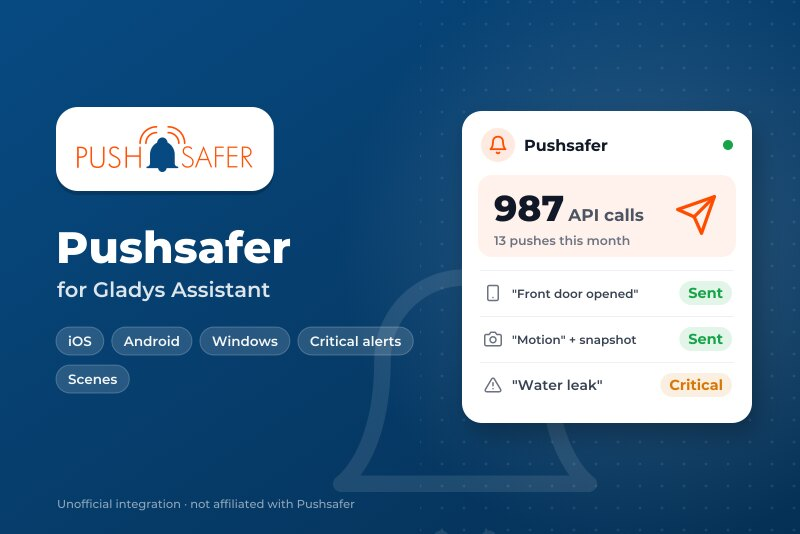
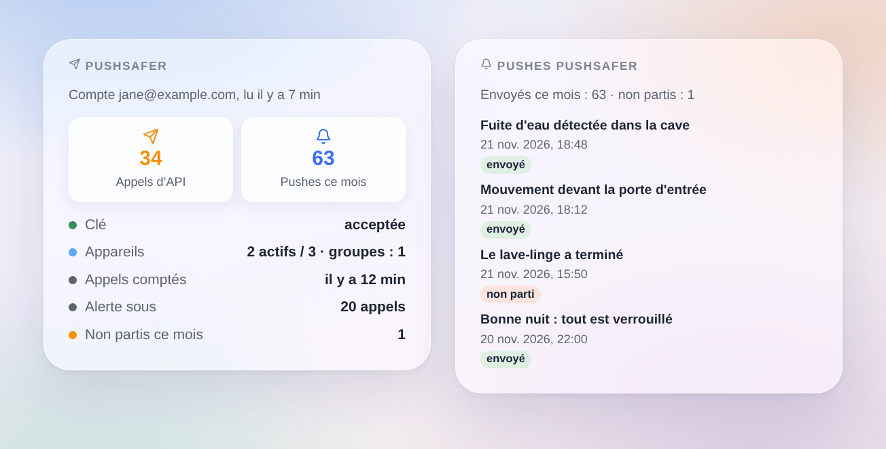
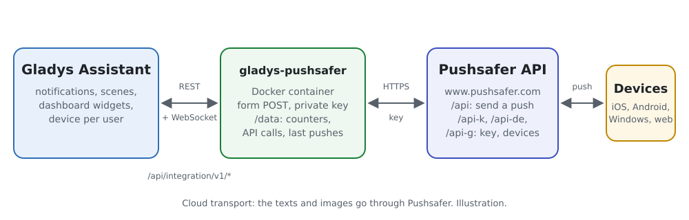
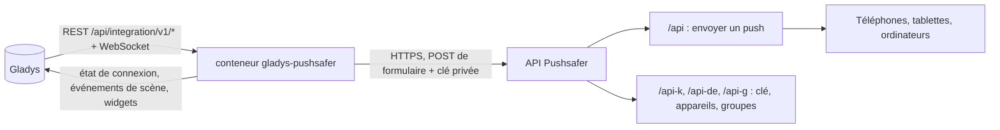
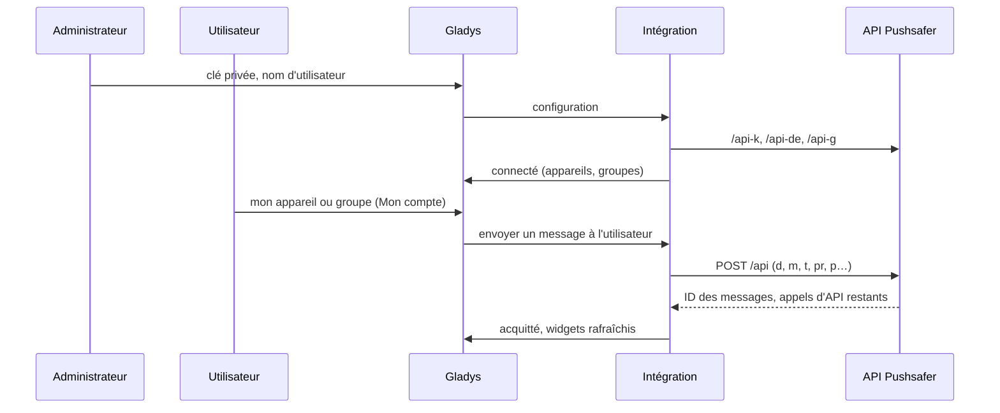

# Gladys Pushsafer

[English](README.md) · **Français** · [Deutsch](README.de.md) · [Español](README.es.md)

[](LICENSE)
[](https://github.com/William-De71/gladys-pushsafer/releases)
[](https://github.com/William-De71/gladys-pushsafer/actions/workflows/release.yml)
[](https://gladysassistant.com)



Intégration externe pour [Gladys Assistant](https://gladysassistant.com) qui envoie les notifications de Gladys **en push [Pushsafer](https://www.pushsafer.com)**, vers iOS, Android, Windows et les navigateurs, avec les instantanés de caméra et des priorités jusqu'aux alertes critiques. Les scènes peuvent aussi envoyer un push à n'importe quel appareil ou groupe et réagir à un échec ou aux appels d'API bientôt épuisés, et deux widgets de tableau de bord affichent le compte et les derniers pushes.

Documentation utilisateur : [English](docs/en.md) · [Français](docs/fr.md) · [Deutsch](docs/de.md) · [Español](docs/es.md).

> Intégration communautaire, ni affiliée à Pushsafer ni approuvée par lui.

## Fonctionnalités

- **Canal de notification** (envoi seul) : chaque utilisateur saisit son appareil ou son groupe d'appareils dans le bloc « Mon compte » ; chaque notification de Gladys qui lui est adressée part en push.
- **Images** : un instantané de caméra joint par Gladys s'affiche dans la notification.
- **Apparence des notifications** : titre, icône, son, vibration, priorité (« Ne pas déranger » contourné, alertes critiques sur iOS) et durée de conservation.
- **Déclencheurs de scène** : push non envoyé, appels d'API bientôt épuisés.
- **Action de scène** : envoyer un push à n'importe quel appareil ou groupe, avec son titre, sa priorité, son son, son icône, sa couleur, son lien, sa durée de conservation et une répétition jusqu'à lecture.
- **Widgets de tableau de bord** : compte Pushsafer, derniers pushes.
- **Boutons de l'écran de configuration** : tester la connexion (liste les appareils et groupes avec leurs ID), envoyer un push de test.
- Anglais, français, allemand et espagnol partout.



## Fonctionnement





De la configuration à un push :



Lire la clé, les appareils et les groupes ne coûte aucun appel d'API ; seuls les pushes en consomment (un par appareil atteint).

### Transport

`transports: ["cloud"]` : l'intégration ne parle qu'à l'API Pushsafer (`www.pushsafer.com`). Les textes et images des notifications quittent votre réseau vers Pushsafer, puis vers les services de notification d'Apple, de Google ou de Microsoft.

## Notifications et appareils

| Saisi dans « Mon compte » | Envoyé à                     |
| ------------------------- | ---------------------------- |
| `a`                       | tous les appareils du compte |
| `52`                      | l'appareil 52                |
| `52, 65` ou `52\|65`      | les appareils 52 et 65       |
| `gs12`                    | le groupe d'appareils gs12   |

« Tester la connexion » liste les ID. L'apparence de la configuration (titre, icône, son, vibration, priorité, durée de conservation) s'applique à toutes les notifications ; un champ vide garde le réglage de l'appareil.

## Déclencheurs, actions de scène et widgets

| Type        | Clé             | Cas d'usage                                                                                          |
| ----------- | --------------- | ---------------------------------------------------------------------------------------------------- |
| Déclencheur | `push_not_sent` | Prévenir par un autre canal quand les pushes ne partent plus (appels d'API, clé, Pushsafer en panne) |
| Déclencheur | `api_calls_low` | Acheter des appels d'API avant qu'ils ne s'épuisent                                                  |
| Action      | `send_push`     | Une alarme en priorité maximale répétée jusqu'à lecture, un push vers un autre groupe                |
| Widget      | `account`       | Appels d'API restants, pushes du mois, clé, appareils, seuil, dernier échec                          |
| Widget      | `recent`        | Les derniers pushes de Gladys, envoyés ou non                                                        |

Exemples : _fuite d'eau_ → push au groupe famille en priorité la plus haute, répété chaque minute jusqu'à lecture ; _appels d'API bientôt épuisés_ → e-mail à l'administrateur ; _push non envoyé_ → SMS par une autre intégration. Une action de scène ne déclenche jamais de déclencheur, et `push_not_sent` ne part qu'une fois tant qu'aucun push n'est repassé : une scène qui prévient par ce même canal ne peut pas boucler.

## Prérequis

- Gladys Assistant 5.3.0 ou plus récent (widgets et scènes, mots-clés du catalogue de Gladys 5.3) ; les instances plus anciennes ne peuvent pas installer l'intégration.
- Un compte Pushsafer, l'application Pushsafer sur les appareils, et des appels d'API (un petit quota gratuit par appareil, puis 0,99 € les 1 000).

## Installation

- **Depuis le store** : Intégrations → Pushsafer → Installer.
- **Depuis l'URL du dépôt** : Intégrations → intégration externe → `https://github.com/William-De71/gladys-pushsafer`.
- **Mode développeur** : lancez `npm start` avec les variables fournies par Gladys (voir Développement).

## Configuration

| Champ                       | Défaut  | Rôle                                                          |
| --------------------------- | ------- | ------------------------------------------------------------- |
| Clé privée                  | —       | `secret`, la clé privée du tableau de bord ou une clé alias   |
| Nom d'utilisateur ou e-mail | —       | Facultatif : vérifier la clé, lister les appareils et groupes |
| Titre                       | Gladys  | Au-dessus de chaque notification                              |
| Icône                       | —       | 1 à 181                                                       |
| Son                         | —       | 0 (silencieux) à 62                                           |
| Vibration                   | —       | 1, 2 ou 3 (iOS et Android)                                    |
| Priorité                    | normale | -2 à 2                                                        |
| Supprimer après (minutes)   | 0       | 0 = jamais                                                    |
| Alerte appels d'API bas     | 20      | Seuil de `api_calls_low`                                      |
| Mon compte → appareil       | —       | Par utilisateur : `a`, `52`, `52\|65` ou `gs12`               |

## Utilisation

1. Recopiez la clé privée depuis le tableau de bord Pushsafer, remplissez la configuration, puis cliquez sur **Tester la connexion** et **Envoyer un push de test**.
2. Chaque utilisateur saisit son appareil ou son groupe dans **Mon compte**.
3. Ajoutez les widgets à un tableau de bord, et créez des scènes avec les déclencheurs et l'action.

## Développement

```bash
npm install
npm test                       # node --test, ne touche jamais au réseau
npm run lint                   # ESLint
npm run format:check           # Prettier
npx github:GladysAssistant/integration-store . --skip-image-check
scripts/build-cover.sh         # cover.jpg depuis docs/assets/cover.svg
docs/illustrations/render.sh   # docs/assets/widgets.<langue>.png
```

En local, le SDK lit `GLADYS_HOST_API_URL`, `GLADYS_INTEGRATION_TOKEN` et `GLADYS_INTEGRATION_SELECTOR` (fournis par Gladys en mode développeur). `DEBUG=gladys-integration-sdk` affiche les journaux du SDK.

Les tests couvrent les cibles, la configuration et ses bornes, les images jointes par Gladys, les réponses de Pushsafer (ses propres statuts HTTP 250 à 280, observés sur le vrai service), la relance (erreur réseau ou 5xx seulement), les événements de scène et leurs transitions à travers un redémarrage, les widgets (`validateWidgetContent`), le manifeste, les quatre langues, le script de release, et toute l'intégration face au faux Gladys du SDK et à une fausse API Pushsafer. `test/structure.test.js` fige toutes les clés que les utilisateurs stockent.

## Processus de release


Chaque fusion sur `main` lance la CI, puis calcule la version à partir des [Conventional Commits](https://www.conventionalcommits.org/) depuis le dernier tag : `feat` → mineure, `fix` / `perf` → correctif, `!` ou `BREAKING CHANGE` → majeure (une mineure sous 1.0.0) ; `docs`, `chore`, `ci`, `test`, `style`, `refactor`, `build` seuls ne publient rien. La section du changelog est générée, le tag poussé, l'image multi-architecture construite, puis `main` reçoit le commit de release, la GitHub Release est créée et un dernier job vérifie l'image publique, le validateur du store et le topic.

- Le titre de la pull request devient le commit squash, puis la ligne du changelog : écrivez-le en anglais, pour l'utilisateur (`pr-title.yml` le vérifie). Ne modifiez jamais `CHANGELOG.md` à la main.
- La 1.0.0 est une décision : Actions → Release → Run workflow avec `release-as: 1.0.0`. `dry-run` affiche la version et les notes sans rien publier.
- **Branche protégée** : la release pousse son commit sur `main` avec `GITHUB_TOKEN`. Avec un ruleset sur `main`, ajoutez GitHub Actions à sa liste de contournement (ou poussez via une GitHub App), sinon le job de publication échoue avec les instructions.
- Après la première release, rendez public le package `ghcr.io` (Package settings → Change visibility), sinon Gladys ne peut pas le télécharger.

## Dépannage

Voir [docs/fr.md](docs/fr.md#dépannage). Signalez les problèmes avec les versions de Gladys et de l'intégration, les plateformes des appareils et les journaux de l'intégration (ne collez jamais la clé privée).

## Contribuer

Les issues et pull requests sont les bienvenues. Lancez `npm run format:check && npm run lint && npm test` avant d'ouvrir une pull request, et ne changez aucune clé stockée (voir [CLAUDE.md](CLAUDE.md)).

## Sécurité

Voir [SECURITY.md](SECURITY.md) : signalez les vulnérabilités en privé. La clé privée est un champ `secret`, jamais journalisée, jamais dans un événement de scène, un widget ou un message d'erreur. Un push n'est relancé qu'une fois, seulement quand Pushsafer n'a pas répondu ou a répondu une 5xx : un doublon est alors possible, un refus de Pushsafer n'est jamais relancé.

## Captures à venir

Les images ci-dessus sont des illustrations, pas des captures d'écran. Les vraies captures iront dans `docs/assets/screenshots/` (PNG, 1280 × 800) : `configuration.png`, `my-account.png`, `scene-action.png`, `dashboard.png`, et une notification sur un téléphone (`notification.png`, 1080 × 1920).

## Licence

[Licence Apache 2.0](LICENSE) — voir aussi [NOTICE](NOTICE). Pushsafer est une marque de son propriétaire ; cette intégration communautaire n'y est pas affiliée. Merci à la documentation et au SDK de Gladys.
