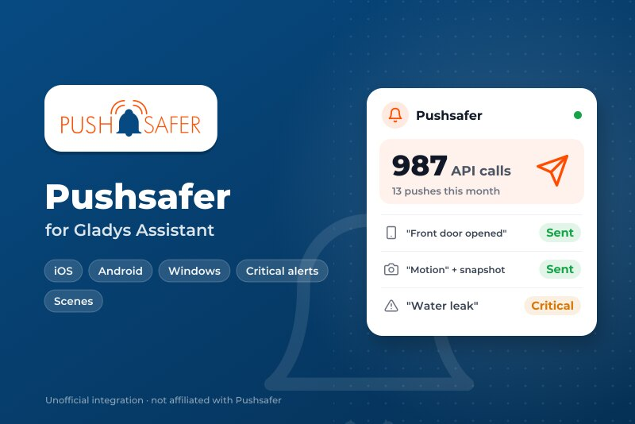
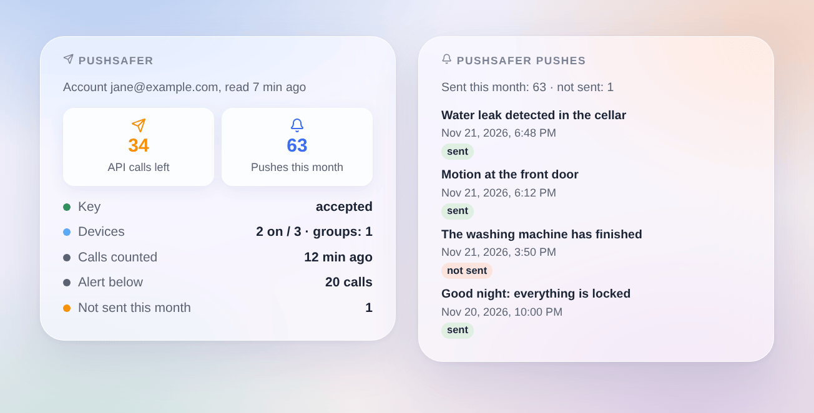
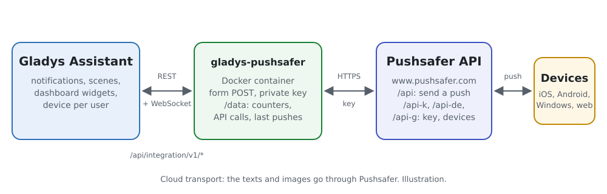
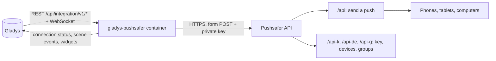
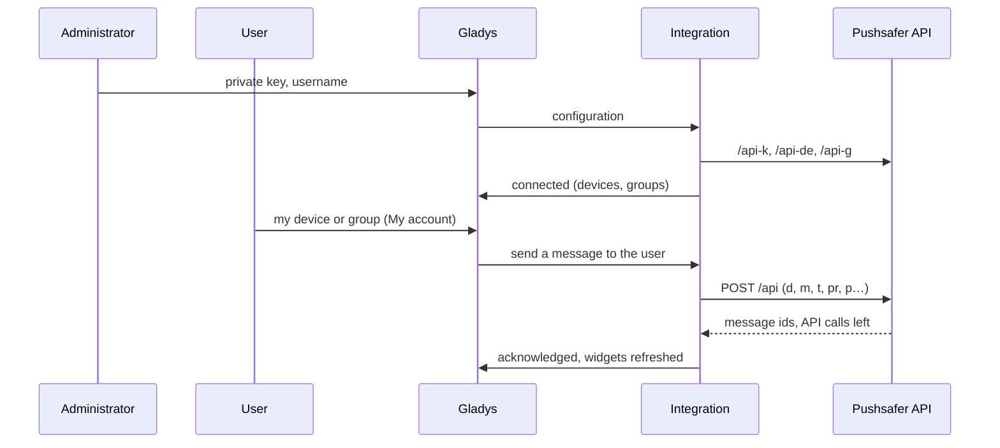

# Gladys Pushsafer

**English** · [Français](README.fr.md) · [Deutsch](README.de.md) · [Español](README.es.md)

[](LICENSE)
[](https://github.com/William-De71/gladys-pushsafer/releases)
[](https://github.com/William-De71/gladys-pushsafer/actions/workflows/release.yml)
[](https://gladysassistant.com)



[Gladys Assistant](https://gladysassistant.com) external integration that sends the notifications of Gladys **as [Pushsafer](https://www.pushsafer.com) pushes**, to iOS, Android, Windows and browsers, with camera snapshots and priorities up to critical alerts. Scenes can also send a push to any device or group and react to a failure or to low API calls, and two dashboard widgets show the account and the last pushes.

User documentation: [English](docs/en.md) · [Français](docs/fr.md) · [Deutsch](docs/de.md) · [Español](docs/es.md).

> Community integration, not affiliated with nor endorsed by Pushsafer.

## Features

- **Notification channel** (send-only): each user enters their device or device group in the "My account" block; every Gladys notification addressed to them leaves as a push.
- **Images**: a camera snapshot attached by Gladys is shown in the notification.
- **Look of the notifications**: title, icon, sound, vibration, priority (Do Not Disturb bypassed, critical alerts on iOS) and time to live.
- **Scene triggers**: push not sent, API calls low.
- **Scene action**: send a push to any device or group, with its own title, priority, sound, icon, color, link, time to live and repetition until read.
- **Dashboard widgets**: Pushsafer account, last pushes.
- **Configuration screen buttons**: test the connection (lists the devices and groups with their IDs), send a test push.
- English, French, German and Spanish everywhere.



## How it works





From the configuration to a push:



Reading the key, the devices and the groups costs no API call; only pushes do (one per device reached).

### Transport

`transports: ["cloud"]`: the integration only talks to the Pushsafer API (`www.pushsafer.com`). The texts and images of the notifications leave your network for Pushsafer, then the notification services of Apple, Google or Microsoft.

## Notifications and devices

| Entered in "My account" | Sent to                     |
| ----------------------- | --------------------------- |
| `a`                     | every device of the account |
| `52`                    | the device 52               |
| `52, 65` or `52\|65`    | the devices 52 and 65       |
| `gs12`                  | the device group gs12       |

"Test the connection" lists the IDs. The look of the configuration (title, icon, sound, vibration, priority, time to live) applies to every notification; an empty field keeps the setting of the device.

## Scene triggers, actions and widgets

| Kind    | Key             | Use case                                                                               |
| ------- | --------------- | -------------------------------------------------------------------------------------- |
| Trigger | `push_not_sent` | Warn through another channel when pushes stop leaving (API calls, key, Pushsafer down) |
| Trigger | `api_calls_low` | Buy API calls before they run out                                                      |
| Action  | `send_push`     | An alarm with the highest priority repeated until read, a push to another group        |
| Widget  | `account`       | API calls left, pushes of the month, key, devices, threshold, last failure             |
| Widget  | `recent`        | The last pushes of Gladys, sent or not                                                 |

Examples: _water leak_ → push to the family group with the highest priority, repeated every minute until read; _API calls low_ → e-mail to the administrator; _push not sent_ → SMS through another integration. A scene action never fires a trigger, and `push_not_sent` fires once until a push goes through: a scene warning through this same channel cannot loop.

## Requirements

- Gladys Assistant 5.3.0 or later (widgets and scenes, catalog keywords of Gladys 5.3); older instances cannot install the integration.
- A Pushsafer account, the Pushsafer app on the devices, and API calls (a small free quota per device, then 0.99 EUR per 1,000).

## Installation

- **From the store**: Integrations → Pushsafer → Install.
- **From the repository URL**: Integrations → external integration → `https://github.com/William-De71/gladys-pushsafer`.
- **Developer mode**: run `npm start` with the variables given by Gladys (see Development).

## Configuration

| Field                  | Default | Meaning                                                    |
| ---------------------- | ------- | ---------------------------------------------------------- |
| Private key            | —       | `secret`, the Private Key of the dashboard or an alias key |
| Username or e-mail     | —       | Optional: check the key, list the devices and groups       |
| Title                  | Gladys  | Above each notification                                    |
| Icon                   | —       | 1 to 181                                                   |
| Sound                  | —       | 0 (silent) to 62                                           |
| Vibration              | —       | 1, 2 or 3 (iOS and Android)                                |
| Priority               | normal  | -2 to 2                                                    |
| Delete after (minutes) | 0       | 0 = never                                                  |
| Low API calls alert    | 20      | Threshold of `api_calls_low`                               |
| My account → device    | —       | Per user: `a`, `52`, `52\|65` or `gs12`                    |

## Usage

1. Copy the private key from the Pushsafer dashboard, fill in the configuration, then click **Test the connection** and **Send a test push**.
2. Each user enters their device or group in **My account**.
3. Add the widgets to a dashboard, and build scenes with the triggers and the action.

## Development

```bash
npm install
npm test                       # node --test, never touches the network
npm run lint                   # ESLint
npm run format:check           # Prettier
npx github:GladysAssistant/integration-store . --skip-image-check
scripts/build-cover.sh         # cover.jpg from docs/assets/cover.svg
docs/illustrations/render.sh   # docs/assets/widgets.<lang>.png
```

Locally, the SDK reads `GLADYS_HOST_API_URL`, `GLADYS_INTEGRATION_TOKEN` and `GLADYS_INTEGRATION_SELECTOR` (given by Gladys in developer mode). `DEBUG=gladys-integration-sdk` shows the SDK logs.

The tests cover the targets, the configuration and its bounds, the images attached by Gladys, the answers of Pushsafer (its own HTTP statuses 250 to 280, seen on the real service), the retry (network error or 5xx only), the scene events and their transitions across a restart, the widgets (`validateWidgetContent`), the manifest, the four languages, the release script, and the whole integration against the fake Gladys of the SDK and a fake Pushsafer API. `test/structure.test.js` freezes every key users store.

## Release process


Every merge on `main` runs the CI, then computes the version from the [Conventional Commits](https://www.conventionalcommits.org/) since the last tag: `feat` → minor, `fix` / `perf` → patch, `!` or `BREAKING CHANGE` → major (a minor below 1.0.0); `docs`, `chore`, `ci`, `test`, `style`, `refactor`, `build` alone publish nothing. The changelog section is generated, the tag pushed, the multi-architecture image built, then `main` receives the release commit, the GitHub Release is created and a last job checks the public image, the store validator and the topic.

- The pull request title becomes the squash commit, then the changelog line: write it in English, for the user (`pr-title.yml` checks it). Never edit `CHANGELOG.md` by hand.
- 1.0.0 is a decision: Actions → Release → Run workflow with `release-as: 1.0.0`. `dry-run` shows the version and the notes without publishing.
- **Protected branch**: the release pushes its commit to `main` with `GITHUB_TOKEN`. With a ruleset on `main`, add GitHub Actions to its bypass list (or push through a GitHub App), otherwise the publish job fails with instructions.
- After the first release, make the `ghcr.io` package public (Package settings → Change visibility), or Gladys cannot pull it.

## Troubleshooting

See [docs/en.md](docs/en.md#troubleshooting). Report issues with the versions of Gladys and of the integration, the platforms of the devices and the logs of the integration (never paste the private key).

## Contributing

Issues and pull requests are welcome. Run `npm run format:check && npm run lint && npm test` before opening a pull request, and keep every stored key unchanged (see [CLAUDE.md](CLAUDE.md)).

## Security

See [SECURITY.md](SECURITY.md): report vulnerabilities privately. The private key is a `secret` field, never logged, never in a scene event, a widget or an error message. A push is retried once only when Pushsafer did not answer or answered a 5xx: a duplicate is then possible, a refusal of Pushsafer is never retried.

## Screenshots to come

The images above are illustrations, not screenshots. Real screenshots will go in `docs/assets/screenshots/` (PNG, 1280 × 800): `configuration.png`, `my-account.png`, `scene-action.png`, `dashboard.png`, and a notification on a phone (`notification.png`, 1080 × 1920).

## License

[Apache License 2.0](LICENSE) — see also [NOTICE](NOTICE). Pushsafer is a trademark of its owner; this community integration is not affiliated with it. Thanks to the Gladys documentation and SDK.
