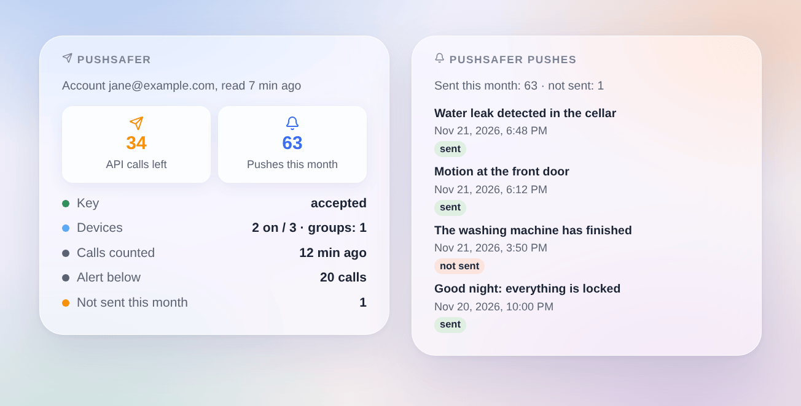

# Pushsafer

## Overview

This integration sends the notifications of Gladys as
[Pushsafer](https://www.pushsafer.com) pushes, to the phones, tablets and
computers where the Pushsafer app is installed (iOS, Android, Windows,
browsers). Each user of Gladys chooses their device or device group; the
administrator enters the private key of the Pushsafer account once for the
house.

It also brings:

- the **look of the notifications**: title, icon, sound, vibration, priority
  (up to the critical alerts of iOS) and time to live;
- the **camera snapshots** attached by Gladys, shown in the notification;
- two **scene triggers**: push not sent, API calls low;
- one **scene action**: send a push to any device or group, with its own
  title, priority, sound, icon, color, link and repetition until read;
- two **dashboard widgets**: the Pushsafer account and the last pushes.

Transport: **cloud**. The texts and the images go through the Pushsafer API
(`www.pushsafer.com`), then through the notification services of Apple,
Google or Microsoft.

## Prerequisites

- Gladys Assistant **5.3.0** or later.
- A **Pushsafer account** (free registration on pushsafer.com) and the
  Pushsafer app on each device that should receive the notifications.
- **API calls**: each push to one device uses one API call (a push to 3
  devices uses 3). A small free quota comes with each device; then 1,000
  calls cost 0.99 EUR, bought in the Pushsafer dashboard.

## Configuration

1. In Gladys, open **Integrations → Pushsafer → Configuration**.
2. Copy the **Private Key** shown in the Pushsafer dashboard (or an alias
   key) into the configuration.
3. Enter the **username or e-mail** of the Pushsafer account: optional to
   send, it lets the integration check the key and list the devices.
4. Choose the look of the notifications if you wish, and save.
5. Click **Test the connection**: it lists the devices and groups with their
   IDs. **Send a test push** checks the whole chain.
6. Each user opens the **My account** block of the same screen and enters
   their **device or group**: `a` for all the devices, a device ID (`52`),
   several IDs (`52|65`) or a group (`gs12`).

| Field                  | Use                                                                             |
| ---------------------- | ------------------------------------------------------------------------------- |
| Private key            | The Private Key of the dashboard, or an alias key, stored encrypted             |
| Username or e-mail     | Optional: to check the key and list the devices and groups                      |
| Title                  | Above each notification (`Gladys` by default)                                   |
| Icon                   | 1 to 181 (1 = the Pushsafer bell); empty = the default icon                     |
| Sound                  | 0 = silent, 1 to 62; empty = the sound of the device                            |
| Vibration              | Short, medium, long (iOS and Android); empty = the setting of the device        |
| Priority               | Lowest to highest; high and highest go through Do Not Disturb                   |
| Delete after (minutes) | The Pushsafer app deletes the message after this time; 0 = never                |
| Low API calls alert    | Below this number of API calls left, "API calls low" fires once (20 by default) |

The icons and sounds are listed on the
[API page of Pushsafer](https://www.pushsafer.com/en/pushapi_ext).

## Usage

### Notifications

Every Gladys notification addressed to a user who entered a device leaves as
a push: alarms, "Send a message" scene actions, the answers of Gladys. An
image attached to the message (a camera snapshot) is shown in the
notification.

The priority **highest** goes through Do Not Disturb; on iOS, it becomes a
critical alert when it is allowed for the Pushsafer app (Settings →
Notifications → Pushsafer). Keep it for the alarms.

### Scene triggers

| Trigger       | When it fires                                                                                | Variables                          |
| ------------- | -------------------------------------------------------------------------------------------- | ---------------------------------- |
| Push not sent | The first failure of a notification, then again only after a push went through (never loops) | reason, HTTP status, error, device |
| API calls low | The API calls left went below the threshold; again only after a top-up above it              | API calls left, threshold          |

Pushsafer only tells the API calls left when a push is sent: the integration
knows them after the first push.

### Scene actions

- **Send a Pushsafer push**: a device or group, a text (scene variables
  allowed) and, if you wish, a title, a priority, a sound, an icon, an icon
  color, a link, a time to live, and a repetition every N
  seconds until the push is opened in the app (each repetition uses one API
  call). Returns the IDs of the messages and the API calls left.

### Scene examples

- _When the water leak sensor detects water_ → send a Pushsafer push to the
  group `gs12` with the priority **highest**, the sound 25 (sirens) and a
  repetition every 60 seconds until read.
- _When the API calls are low_ → send an e-mail to the administrator: "Only
  {{triggerEvent.data.api_calls_left}} Pushsafer API calls left".
- _When a push is not sent_ → send the alert through another channel (SMS,
  e-mail) with `{{triggerEvent.data.reason}}`.

### Dashboard widgets

- **Pushsafer**: API calls left (orange near the threshold, red below), the
  pushes of the month, the state of the key, the devices and groups, the
  threshold and the last failure.
- **Pushsafer pushes**: the last pushes of Gladys, sent or not; tap one to
  read it whole, with its device and the reason of a failure.

## Troubleshooting

- **"Pushsafer refuses the key"**: copy the Private Key again from the
  dashboard, and check the username or e-mail of the account.
- **"Device refused"**: the ID does not belong to the account, or the device
  was deleted; "Test the connection" lists the valid IDs.
- **"No API calls left"**: buy API calls in the Pushsafer dashboard.
- **The push arrives without sound**: the priority "low" or "lowest", the
  sound 0, or Do Not Disturb with the priority "normal".
- **A push arrived twice**: when Pushsafer does not answer, the integration
  tries once more, and the first try had sometimes gone through.
- **Logs**: Integrations → Pushsafer → Supervision tab. The private key never
  appears.
