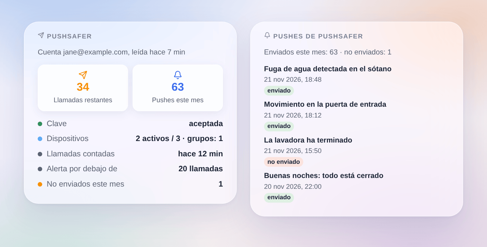

# Pushsafer

## Presentación

Esta integración envía las notificaciones de Gladys como push de
[Pushsafer](https://www.pushsafer.com) a los teléfonos, tabletas y
ordenadores donde está instalada la aplicación Pushsafer (iOS, Android,
Windows, navegadores). Cada usuario de Gladys elige su dispositivo o su grupo
de dispositivos; el administrador introduce una sola vez la clave privada de
la cuenta de Pushsafer de la casa.

También aporta:

- el **aspecto de las notificaciones**: título, icono, sonido, vibración,
  prioridad (hasta las alertas críticas de iOS) y tiempo de conservación;
- las **imágenes de cámara** que adjunta Gladys, mostradas en la
  notificación;
- dos **disparadores de escena**: push no enviado, pocas llamadas a la API;
- una **acción de escena**: enviar un push a cualquier dispositivo o grupo,
  con su título, prioridad, sonido, icono, color, enlace y repetición hasta
  que se lea;
- dos **widgets del panel**: la cuenta de Pushsafer y los últimos pushes.

Transporte: **nube**. Los textos y las imágenes pasan por la API de
Pushsafer (`www.pushsafer.com`) y luego por los servicios de notificación de
Apple, Google o Microsoft.

## Requisitos previos

- Gladys Assistant **5.3.0** o posterior.
- Una **cuenta de Pushsafer** (registro gratuito en pushsafer.com) y la
  aplicación Pushsafer en cada dispositivo que deba recibir las
  notificaciones.
- **Llamadas a la API**: cada push a un dispositivo consume una llamada a la
  API (un push a 3 dispositivos consume 3). Cada dispositivo incluye una
  pequeña cuota gratuita; después, 1000 llamadas cuestan 0,99 €, compradas en
  el panel de Pushsafer.

## Configuración

1. En Gladys, abra **Integraciones → Pushsafer → Configuración**.
2. Copie en la configuración la **clave privada** (Private Key) que muestra
   el panel de Pushsafer (o una clave alias).
3. Introduzca el **nombre de usuario o el correo** de la cuenta de
   Pushsafer: opcional para enviar, permite comprobar la clave y listar los
   dispositivos.
4. Elija si lo desea el aspecto de las notificaciones y guarde.
5. Pulse **Probar la conexión**: lista los dispositivos y grupos con sus ID.
   **Enviar un push de prueba** comprueba toda la cadena.
6. Cada usuario abre el bloque **Mi cuenta** de la misma pantalla e
   introduce su **dispositivo o grupo**: `a` para todos los dispositivos, un
   ID de dispositivo (`52`), varios ID (`52|65`) o un grupo (`gs12`).

| Campo                    | Uso                                                                                                          |
| ------------------------ | ------------------------------------------------------------------------------------------------------------ |
| Clave privada            | La clave privada del panel, o una clave alias, guardada cifrada                                              |
| Usuario o correo         | Opcional: para comprobar la clave y listar dispositivos y grupos                                             |
| Título                   | Encima de cada notificación (`Gladys` por defecto)                                                           |
| Icono                    | 1 a 181 (1 = la campana de Pushsafer); vacío = el icono por defecto                                          |
| Sonido                   | 0 = silencio, 1 a 62; vacío = el sonido del dispositivo                                                      |
| Vibración                | Corta, media, larga (iOS y Android); vacío = el ajuste del dispositivo                                       |
| Prioridad                | De mínima a máxima; alta y máxima ignoran «No molestar»                                                      |
| Borrar tras (minutos)    | La aplicación Pushsafer borra el mensaje tras este tiempo; 0 = nunca                                         |
| Alerta de pocas llamadas | Por debajo de este número de llamadas restantes, «Pocas llamadas a la API» se lanza una vez (20 por defecto) |

Los iconos y los sonidos figuran en la
[página de la API de Pushsafer](https://www.pushsafer.com/en/pushapi_ext).

## Uso

### Notificaciones

Toda notificación de Gladys dirigida a un usuario que indicó un dispositivo
sale como push: alarmas, acciones de escena «Enviar un mensaje», respuestas
de Gladys. Una imagen adjunta al mensaje (una imagen de cámara) se muestra en
la notificación.

La prioridad **máxima** ignora «No molestar»; en iOS se convierte en alerta
crítica si la aplicación Pushsafer tiene permiso (Ajustes → Notificaciones →
Pushsafer). Resérvela para las alarmas.

### Disparadores de escena

| Disparador              | Cuándo se lanza                                                                                 | Variables                               |
| ----------------------- | ----------------------------------------------------------------------------------------------- | --------------------------------------- |
| Push no enviado         | Con el primer fallo de una notificación, y de nuevo solo tras un push correcto (nunca en bucle) | motivo, estado HTTP, error, dispositivo |
| Pocas llamadas a la API | Las llamadas a la API restantes bajaron del umbral; de nuevo solo tras una recarga por encima   | llamadas restantes, umbral              |

Pushsafer solo indica las llamadas a la API restantes al enviar un push: la
integración las conoce tras el primer push.

### Acciones de escena

- **Enviar un push de Pushsafer**: un dispositivo o un grupo, un texto (se
  permiten variables de escena) y, si lo desea, un título, una prioridad, un
  sonido, un icono, un color de icono, un enlace, un tiempo de
  conservación y una repetición cada N segundos hasta que el push se abra en
  la aplicación (cada repetición consume una llamada a la API). Devuelve los
  ID de los mensajes y las llamadas a la API restantes.

### Ejemplos de escenas

- _Cuando el detector de fugas detecta agua_ → enviar un push de Pushsafer
  al grupo `gs12` con la prioridad **máxima**, el sonido 25 (sirenas) y una
  repetición cada 60 segundos hasta que se lea.
- _Cuando quedan pocas llamadas a la API_ → enviar un correo al
  administrador: «Solo quedan {{triggerEvent.data.api_calls_left}} llamadas
  a la API de Pushsafer».
- _Cuando un push no se envía_ → enviar la alerta por otro canal (SMS,
  correo) con `{{triggerEvent.data.reason}}`.

### Widgets del panel

- **Pushsafer**: llamadas a la API restantes (naranja cerca del umbral, rojo
  por debajo), los pushes del mes, el estado de la clave, los dispositivos y
  grupos, el umbral y el último fallo.
- **Pushes de Pushsafer**: los últimos pushes de Gladys, enviados o no;
  toque uno para leerlo entero, con su dispositivo y el motivo de un fallo.

## Solución de problemas

- **«Pushsafer rechaza la clave»**: copie de nuevo la clave privada desde el
  panel y compruebe el nombre de usuario o el correo de la cuenta.
- **«Dispositivo rechazado»**: el ID no pertenece a la cuenta o el
  dispositivo se eliminó; «Probar la conexión» lista los ID válidos.
- **«Sin llamadas a la API»**: compre llamadas a la API en el panel de
  Pushsafer.
- **El push llega sin sonido**: prioridad «baja» o «mínima», sonido 0, o «No
  molestar» con la prioridad «normal».
- **Un push llegó dos veces**: cuando Pushsafer no responde, la integración
  lo intenta una vez más, y a veces el primer intento ya había llegado.
- **Registros**: Integraciones → Pushsafer → pestaña Supervisión. La clave
  privada nunca aparece.
