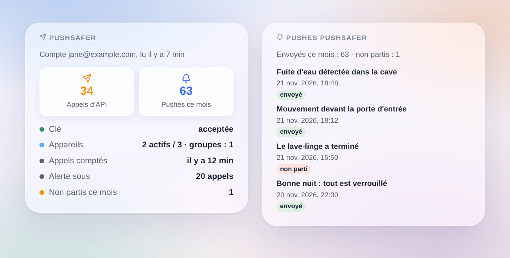

# Pushsafer

## Présentation

Cette intégration envoie les notifications de Gladys en push
[Pushsafer](https://www.pushsafer.com), vers les téléphones, tablettes et
ordinateurs où l'application Pushsafer est installée (iOS, Android, Windows,
navigateurs). Chaque utilisateur de Gladys choisit son appareil ou son groupe
d'appareils ; l'administrateur saisit une seule fois la clé privée du compte
Pushsafer de la maison.

Elle apporte aussi :

- l'**apparence des notifications** : titre, icône, son, vibration, priorité
  (jusqu'aux alertes critiques d'iOS) et durée de conservation ;
- les **instantanés de caméra** joints par Gladys, affichés dans la
  notification ;
- deux **déclencheurs de scène** : push non envoyé, appels d'API bientôt
  épuisés ;
- une **action de scène** : envoyer un push à n'importe quel appareil ou
  groupe, avec son titre, sa priorité, son son, son icône, sa couleur, son
  lien et une répétition jusqu'à lecture ;
- deux **widgets de tableau de bord** : le compte Pushsafer et les derniers
  pushes.

Transport : **cloud**. Les textes et les images passent par l'API Pushsafer
(`www.pushsafer.com`), puis par les services de notification d'Apple, de
Google ou de Microsoft.

## Prérequis

- Gladys Assistant **5.3.0** ou plus récent.
- Un **compte Pushsafer** (inscription gratuite sur pushsafer.com) et
  l'application Pushsafer sur chaque appareil qui doit recevoir les
  notifications.
- Des **appels d'API** : chaque push vers un appareil consomme un appel
  d'API (un push vers 3 appareils en consomme 3). Un petit quota gratuit est
  offert par appareil ; ensuite 1 000 appels coûtent 0,99 €, achetés dans le
  tableau de bord Pushsafer.

## Configuration

1. Dans Gladys, ouvrez **Intégrations → Pushsafer → Configuration**.
2. Recopiez la **clé privée** (Private Key) affichée dans le tableau de bord
   Pushsafer (ou une clé alias) dans la configuration.
3. Saisissez le **nom d'utilisateur ou l'e-mail** du compte Pushsafer :
   facultatif pour envoyer, il permet de vérifier la clé et de lister les
   appareils.
4. Choisissez si vous le souhaitez l'apparence des notifications, puis
   enregistrez.
5. Cliquez sur **Tester la connexion** : elle liste les appareils et groupes
   avec leurs ID. **Envoyer un push de test** vérifie toute la chaîne.
6. Chaque utilisateur ouvre le bloc **Mon compte** du même écran et saisit
   son **appareil ou groupe** : `a` pour tous les appareils, un ID d'appareil
   (`52`), plusieurs ID (`52|65`) ou un groupe (`gs12`).

| Champ                       | Usage                                                                                            |
| --------------------------- | ------------------------------------------------------------------------------------------------ |
| Clé privée                  | La clé privée du tableau de bord, ou une clé alias, stockée chiffrée                             |
| Nom d'utilisateur ou e-mail | Facultatif : pour vérifier la clé et lister les appareils et groupes                             |
| Titre                       | Au-dessus de chaque notification (`Gladys` par défaut)                                           |
| Icône                       | 1 à 181 (1 = la cloche Pushsafer) ; vide = l'icône par défaut                                    |
| Son                         | 0 = silencieux, 1 à 62 ; vide = le son de l'appareil                                             |
| Vibration                   | Courte, moyenne, longue (iOS et Android) ; vide = le réglage de l'appareil                       |
| Priorité                    | De la plus basse à la plus haute ; haute et la plus haute passent « Ne pas déranger »            |
| Supprimer après (minutes)   | L'application Pushsafer supprime le message après ce délai ; 0 = jamais                          |
| Alerte appels d'API bas     | Sous ce nombre d'appels restants, « Appels d'API bientôt épuisés » part une fois (20 par défaut) |

Les icônes et les sons sont listés sur la
[page de l'API de Pushsafer](https://www.pushsafer.com/en/pushapi_ext).

## Utilisation

### Notifications

Toute notification de Gladys adressée à un utilisateur qui a saisi un
appareil part en push : alarmes, actions de scène « Envoyer un message »,
réponses de Gladys. Une image jointe au message (un instantané de caméra)
s'affiche dans la notification.

La priorité **la plus haute** passe outre « Ne pas déranger » ; sur iOS, elle
devient une alerte critique si l'application Pushsafer y est autorisée
(Réglages → Notifications → Pushsafer). Réservez-la aux alarmes.

### Déclencheurs de scène

| Déclencheur                  | Quand il se déclenche                                                                                  | Variables                             |
| ---------------------------- | ------------------------------------------------------------------------------------------------------ | ------------------------------------- |
| Push non envoyé              | Au premier échec d'une notification, puis seulement après qu'un push est repassé (jamais de boucle)    | raison, statut HTTP, erreur, appareil |
| Appels d'API bientôt épuisés | Les appels d'API restants sont passés sous le seuil ; à nouveau seulement après une recharge au-dessus | appels d'API restants, seuil          |

Pushsafer n'indique les appels d'API restants qu'à l'envoi d'un push :
l'intégration les connaît après le premier push.

### Actions de scène

- **Envoyer un push Pushsafer** : un appareil ou un groupe, un texte (les
  variables de scène sont permises) et, si vous le souhaitez, un titre, une
  priorité, un son, une icône, une couleur d'icône, un lien,
  une durée de conservation, et une répétition toutes les N secondes jusqu'à
  ce que le push soit ouvert dans l'application (chaque répétition consomme
  un appel d'API). Renvoie les ID des messages et les appels d'API restants.

### Exemples de scènes

- _Quand le détecteur de fuite d'eau détecte de l'eau_ → envoyer un push
  Pushsafer au groupe `gs12` avec la priorité **la plus haute**, le son 25
  (sirènes) et une répétition toutes les 60 secondes jusqu'à lecture.
- _Quand les appels d'API sont bientôt épuisés_ → envoyer un e-mail à
  l'administrateur : « Plus que {{triggerEvent.data.api_calls_left}} appels
  d'API Pushsafer ».
- _Quand un push n'est pas envoyé_ → envoyer l'alerte par un autre canal
  (SMS, e-mail) avec `{{triggerEvent.data.reason}}`.

### Widgets de tableau de bord

- **Pushsafer** : appels d'API restants (orange près du seuil, rouge en
  dessous), les pushes du mois, l'état de la clé, les appareils et groupes,
  le seuil et le dernier échec.
- **Pushes Pushsafer** : les derniers pushes de Gladys, envoyés ou non ;
  touchez-en un pour le lire en entier, avec son appareil et la raison d'un
  échec.

## Dépannage

- **« Pushsafer refuse la clé »** : recopiez la clé privée depuis le tableau
  de bord, et vérifiez le nom d'utilisateur ou l'e-mail du compte.
- **« Appareil refusé »** : l'ID n'appartient pas au compte, ou l'appareil a
  été supprimé ; « Tester la connexion » liste les ID valides.
- **« Plus d'appels d'API »** : achetez des appels d'API dans le tableau de
  bord Pushsafer.
- **Le push arrive sans son** : priorité « basse » ou « la plus basse », son
  0, ou « Ne pas déranger » avec la priorité « normale ».
- **Un push est arrivé deux fois** : quand Pushsafer ne répond pas,
  l'intégration réessaie une fois, et le premier essai était parfois passé.
- **Journaux** : Intégrations → Pushsafer → onglet Supervision. La clé privée
  n'y apparaît jamais.
